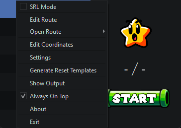

<h1 align="center">AutoSplit64+ <sub>(Linux port)</sub></h1>
<p align="center">
    
</p>
<p align="center">
    Automatic LiveSplit timing for Super Mario 64 console speedruns — now running natively on Linux.
</p>

---

## What is this?

**AutoSplit64+** watches your captured SM64 gameplay and drives your LiveSplit
timer for you: it counts stars, detects fade-outs, X-Cam, DDD entry, the final
star and console resets, and fires a split at exactly the right moment based on
a route you define. No hotkeys to hit mid-run, no manual splitting.

This repository is a **Linux port** of
[DaviBe92/AutoSplit64plus](https://github.com/DaviBe92/AutoSplit64plus) (itself
an enhanced fork of [Kainev/AutoSplit64](https://github.com/Kainev/AutoSplit64)).
The upstream project is Windows-only; this port makes the same tool run on
Linux without Wine, with Linux-native capture and timer integration.

### What the port adds

| Area | Upstream (Windows) | This port (Linux) |
|------|--------------------|-------------------|
| **Frame capture** | OBS plugin (Win32 shared memory) or Win32 window capture | OBS plugin rebuilt on **POSIX shared memory** (`/dev/shm`), **or** direct capture card via **V4L2** (OpenCV) |
| **Timer control** | LiveSplit Server (TCP) / named pipe | LiveSplit TCP **or** the **OBS LiveSplit One** source driven over **OBS WebSocket** |
| **Packaging** | `AutoSplit64plus.exe` (PyInstaller) | Single self-contained **AppImage** (bundles its own Python 3.12 + Qt) |
| **Paths** | Everything relative to the install folder | XDG dirs — config in `~/.config/autosplit64`, data/logs in `~/.local/share/autosplit64` |

Everything else — the recognition engine, the route format, the `.lss`
importer, the GUI — is the upstream code, kept intact so routes and behaviour
stay familiar.

## Key features

- Automatic split timing driven by on-screen events
- Star-count, fade-out/fade-in, DDD-entry, final-star, X-Cam and death detection
- Console reset detection
- Custom route creation, plus one-click **import of your existing LiveSplit `.lss`**
- Two capture paths (OBS plugin / V4L2 capture card) and two timer paths
  (LiveSplit TCP / OBS LiveSplit One)
- Optional **remember-window-position** and a **"Pop Out LiveSplit View"**
  projector button (see [Using it](#using-it))

## Requirements

- **Linux**, x86-64
- **Python 3.12** *(only if running from source — the AppImage bundles its own)*
- **LiveSplit** 1.8.29+ (via Wine/VM) **or** the **obs-livesplit-one** OBS plugin
- **OBS Studio 30+** if you use OBS for capture and/or timing
- A **capture device/card** for your console

## Install

### Easiest — the install script

One command installs the app **and** builds the OBS capture plugin for your
OBS. It asks what you want, detects your distro, and does the rest:

```bash
curl -sSL https://raw.githubusercontent.com/kindacompiles/AutoSplit64-Linux/main/install.sh | bash
```

It downloads the latest AppImage, adds a menu entry, and (if you choose)
compiles the frame-grabber plugin and drops it into the right OBS folder —
native **or** Flatpak OBS. It only ever uses `sudo` to install build
dependencies, and always asks first. Re-run it anytime to update.

> Prefer to inspect it first? [Read `install.sh`](install.sh) — it's plain bash.
> The manual options below do exactly the same steps by hand.

### Option A — AppImage (manual)

Download the latest `AutoSplit64-*.AppImage`, then:

```bash
chmod +x AutoSplit64-*.AppImage
./AutoSplit64-*.AppImage
```

No Python, no virtualenv, no system packages — it's all inside the AppImage.
Your settings and logs live in `~/.config/autosplit64` and
`~/.local/share/autosplit64`, so updating is just swapping the file.

> Building the AppImage yourself is a one-command container build — see
> [`packaging/README.md`](packaging/README.md).

> ### ⚠️ The OBS capture plugin is **not** inside the AppImage
> If you capture through OBS (the preferred method), you must build the small
> frame-grabber `.so` **once on your own machine** — it loads into OBS, not into
> AutoSplit64, so it can't ship inside the AppImage, and it's compiled against
> *your* OBS version. The install script above does this for you; to do it by
> hand it's a one-command build:
>
> ```bash
> cd obs-plugin/linux && ./build.sh
> # → build/autosplit64plus-framegrabber.so
> ```
>
> Then install it and add the filter in OBS — full steps (including Flatpak OBS
> and the per-user install path) are in
> [`obs-plugin/linux/README.md`](obs-plugin/linux/README.md).
> *(Using a V4L2 capture card instead? You don't need the plugin at all.)*

### Option B — from source

```bash
git clone https://github.com/kindacompiles/AutoSplit64-Linux.git
cd AutoSplit64-Linux
python3.12 -m venv .venv && source .venv/bin/activate
pip install -r requirements.txt
python AutoSplit64.py
```

## First-time setup

AutoSplit64 needs three things wired up: **a timer to control**, **a frame
source to watch**, and **a route that says when to split**.

### 1. Timer

Right-click the main window → **Settings → Connection → Timer Method**:

- **OBS LiveSplit One** *(no separate LiveSplit install)* — add a *LiveSplit
  One* source in OBS (install the `obs-livesplit-one` plugin). AutoSplit64
  controls it over OBS WebSocket (enable **Tools → WebSocket Server Settings**
  in OBS; default `localhost:4455`). Set the host/port/password to match.
- **LiveSplit (TCP)** — run LiveSplit with its TCP server. Because resets are
  detected only when the SM64 logo appears, set LiveSplit's
  **Edit Splits → Start Timer at** to **1.36** seconds.

Click **Test Connection** to confirm it finds your timer.

### 2. Capture

Right-click → **Edit Coordinates**. Pick how AutoSplit64 sees the game:

- **OBS plugin** *(preferred)* — **this plugin is not bundled in the AppImage;
  build it yourself once** (`cd obs-plugin/linux && ./build.sh`, see
  [`obs-plugin/linux/README.md`](obs-plugin/linux/README.md) for install), then
  add the **AS64+ Frame grabber** effect filter to your SM64 source in OBS and
  tick **Use OBS Plugin** here. The plugin copies frames *before* OBS applies
  any resizing/overlays, so your scene layout never affects recognition.
- **V4L2 capture card** — untick **Use OBS Plugin** and choose your
  `/dev/videoN` device. This reads the card directly. Note: only **one** program
  can open a V4L2 device at a time, so you can't share the card with OBS while
  using this mode.

Press **Capture Screen** to preview a frame, then **Auto Detect Region** (do
this on a bright frame, e.g. a star-select screen). Nudge the region so it sits
**1–2 px inside** the game image — never outside it — then **Apply**.

### 3. Route

Right-click → **Edit Route**. The fastest start is **File → Convert LSS** to
import the `.lss` you already use in LiveSplit; check each split afterward.

Then right-click → **Start**. 🎮

## Using it

All windows and options live in the **right-click menu** of the main window:



A few Linux-port conveniences:

- **Remember Window Position** — *Settings → General*. When on (default), the
  app reopens where you last left it (falling back to the default spot if that
  monitor is gone).
- **Pop Out LiveSplit View** — right-click → *Pop Out LiveSplit View* opens a
  windowed OBS projector of your LiveSplit One source at a saved size/position,
  so you don't have to set it up by hand each session. *(Requires the OBS
  LiveSplit One timer method.)* The geometry is stored as
  `connection.obs_projector_geometry` in `~/.config/autosplit64/config.ini`.

## Troubleshooting

Run through these if splitting misbehaves:

- Recheck the capture region (**Edit Coordinates**) — a region even 1 px outside
  the game area breaks recognition.
- Confirm the right **route** is loaded and its star / fade counts are correct.
- **Generate Reset Templates** (right-click menu) if reset detection is off.
- Disable **SRL Mode** if you want console-reset detection.
- Keep capture colours near default; very dull whites hurt star-select
  detection (bump brightness on unpowered splitters).
- Aim for a **4:3** capture aspect ratio.
- **`could not load the Qt platform plugin "xcb"`** from the AppImage → see the
  troubleshooting notes in [`packaging/README.md`](packaging/README.md).
- Logs are written to `~/.local/share/autosplit64/autosplit64.log`.

## Building

- **The app** → [from source](#option-b--from-source), above.
- **The AppImage** → [`packaging/README.md`](packaging/README.md).
- **The OBS frame-grabber plugin** → [`obs-plugin/linux/README.md`](obs-plugin/linux/README.md).
- **How it all fits together (architecture, data flow, internals)** →
  [`docs/DEVELOPMENT.md`](docs/DEVELOPMENT.md).

## Credits

- **AutoSplit64+** — [Davi Be](https://github.com/DaviBe92/AutoSplit64plus) (the fork this port is based on)
- **AutoSplit64** — [Synozure / Kainev](https://github.com/Kainev/AutoSplit64) (the original)
- **Star Classifier** — [Gerardo Cervantes](https://github.com/gerardocervantes8/Star-Classifier-For-Mario-64)
- The POSIX shared-memory capture approach follows the earlier Linux forks
  **SmolAlli/AutoSplit64plusLinux** and **Poke711/AutoSplit64plusLinux**.

The Linux port work in this repository was done with assistance from
**[Claude Code](https://claude.com/claude-code)** (Anthropic).

## License

GPLv3 — see [`LICENSE`](LICENSE). This port inherits the upstream license.
